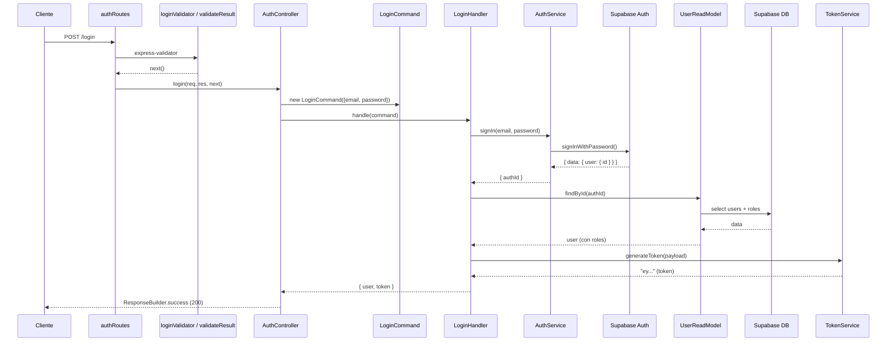
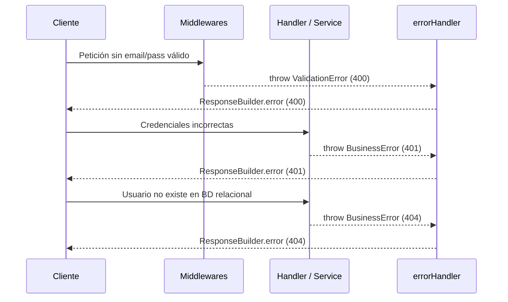

# Reporte Técnico: Funcionalidad "Login / Autenticación"

## 1. Resumen
La funcionalidad de Login permite a los usuarios autenticarse proporcionando su correo electrónico y contraseña. Valida las credenciales utilizando Supabase Auth, recupera los datos y roles del usuario desde la base de datos, y genera un token JWT (JSON Web Token) junto con la información del perfil, devolviéndolo en una respuesta estandarizada.

## 2. Mapa de archivos involucrados

| Archivo | Capa | Responsabilidad |
|---------|------|-----------------|
| `src/routes/authRoutes.js` | Enrutamiento | Define la ruta `POST /login` y orquesta los middlewares de validación y el controlador. |
| `src/validators/userValidator.js` | Middleware/Validación | Define las reglas HTTP para `email` y `password` en el login. |
| `src/utils/validatorHelpers.js` | Middleware/Validación | Ejecuta las reglas de `express-validator` y emite un `ValidationError` si fallan. |
| `src/controllers/AuthController.js` | Controlador | Transforma el request (email, password) en un `Command` y ejecuta el caso de uso. |
| `src/commands/auth/LoginCommand.js` | Comando (DTO) | Estructura inmutable que transporta las credenciales del usuario. |
| `src/commands/auth/LoginHandler.js` | Manejador (Handler) | Orquesta la autenticación delegando a los servicios de Auth, BD y JWT. |
| `src/services/AuthService.js` | Servicio Externo | Se integra con `supabase.auth.signInWithPassword` para validar credenciales. |
| `src/repositories/UserReadModel.js` | Repositorio (Lectura) | Obtiene los detalles del usuario y sus roles desde la tabla `users` y `user_roles`. |
| `src/services/TokenService.js` | Servicio Interno | Genera y firma el JSON Web Token con los datos de sesión. |
| `src/config/container.js` | Inyección de Dependencias | Configura e instancia `AuthService`, `TokenService`, `UserReadModel` y el `LoginHandler`. |
| `src/middlewares/errorHandler.js` | Middleware | Captura y responde de forma estándar si hay errores (`BusinessError`, validaciones). |
| `src/utils/responseBuilder.js` | Presentación | Formatea las respuestas de éxito (`success`) o error (`error`). |

## 3. Diagramas de Flujo

### Flujo Completo y Éxito


### Rutas de Error


## 4. Flujo Paso a Paso

### 1. `src/routes/authRoutes.js`
Inicia el flujo recibiendo la petición POST y asignando validadores antes de llamar al controlador.
```javascript
router.post('/login', loginValidator, validateResult, AuthController.login);
```

### 2. `src/validators/userValidator.js`
Valida de forma declarativa (con express-validator) que el campo `email` tenga formato de correo y que el `password` no esté vacío. 
```javascript
const loginValidator = [
  body('email').isEmail().withMessage('Debe ingresar un email válido'),
  body('password').notEmpty().withMessage('La contraseña es obligatoria')
];
```

### 3. `src/controllers/AuthController.js`
Recibe los datos del cuerpo de la petición, crea un `LoginCommand` y lo pasa al `loginHandler`. El resultado se encapsula en una respuesta HTTP 200 usando `ResponseBuilder`.
```javascript
const { email, password } = req.body;
const command = new LoginCommand({ email, password });
const result = await loginHandler.handle(command);
return ResponseBuilder.success(res, result, 'Inicio de sesion exitoso');
```

### 4. `src/commands/auth/LoginHandler.js`
Es el orquestador del caso de uso. Primero valida las credenciales a través de `AuthService`, luego busca el perfil y rol del usuario mediante `UserReadModel`, genera el token JWT con `TokenService` y finalmente mapea la respuesta devuelta.
```javascript
const { authId } = await this.authService.signIn(command.email, command.password);
const user = await this.userReadModel.findById(authId);
const token = this.tokenService.generateToken({ ... });
return { user, token };
```

### 5. `src/services/AuthService.js`
Se encarga de comunicarse con la API de autenticación de Supabase. Si falla, oculta los detalles de implementación y lanza un `BusinessError` con código 401.
```javascript
async signIn(email, password) {
  const { data, error } = await this.authClient.auth.signInWithPassword({ email, password });
  if (error) throw new BusinessError('Credenciales invalidas', 401);
  return { authId: data.user.id };
}
```

### 6. `src/repositories/UserReadModel.js`
Realiza un JOIN en la base de datos (con las tablas `users`, `user_roles` y `roles`) usando Supabase JS client, para obtener toda la información pública del usuario a partir del ID de Auth.
```javascript
const { data, error } = await this.supabase
  .from('users').select(`id, full_name, apellido_pat, apellido_mat, tel, user_roles (roles (descripcion))`)
  .eq('id', id).single();
```

### 7. `src/services/TokenService.js`
Firma la información de sesión utilizando la librería `jsonwebtoken` y un secreto definido en la configuración.
```javascript
generateToken(payload) {
  return jwt.sign(payload, this.jwtConfig.secret, { expiresIn: this.jwtConfig.expiresIn });
}
```

## 5. Capas de Validación
- **Validación HTTP (`express-validator` en `userValidator.js`):** Valida la presencia de un email con formato correcto y la existencia del password para evitar llamadas innecesarias a Supabase.
- **Validación de Credenciales (`AuthService.js`):** El servicio Supabase Auth valida que el email y la contraseña coincidan en el sistema de identidades.
- **Validación de Integridad Relacional (`LoginHandler.js`):** Verifica que el ID de autenticación provisto exista en la tabla `users` (`if (!user) throw new BusinessError('Usuario no encontrado...', 404)`), garantizando que el usuario esté correctamente sincronizado/registrado.

## 6. Manejo de Errores
- **Validación de Request:** Falla con un array de `ValidationError` que se transforman en una respuesta HTTP 400 mediante el middleware de errores global.
- **Fallo de Credenciales:** Lanza `BusinessError` (401) en `AuthService`. Este pasa por el `catch` del controlador y el `errorHandler` lo despacha con `ResponseBuilder.error` de manera estándar.
- **Fallo de Integridad de Usuario:** Lanza `BusinessError` (404) en `LoginHandler` al no encontrar al usuario en la BD.

## 7. CQRS
Aunque el login (y la autenticación de usuarios) es típicamente visto como una operación de lectura, en este proyecto se modela dentro del patrón `Command` (`LoginCommand`, `LoginHandler`). Esto se debe a que genera y devuelve un token con estado de autenticación (un side-effect lógico, aunque en BD no cambie estado transaccional local). Utiliza un `ReadModel` (`UserReadModel`) para leer el perfil del usuario, respetando correctamente la segregación de consultas de lectura en BD, pero lo orquesta dentro de un handler de comando.

## 8. SOLID
- **(S) Responsabilidad Única (SRP):** 
  - **Cumple ampliamente:** El proceso está muy bien dividido. `AuthService` solo habla con Auth, `UserReadModel` solo lee de BD, `TokenService` solo genera JWTs, y `LoginHandler` solo orquesta. Evidencia: `src/services/TokenService.js` es un ejemplo perfecto de delegación aislada.
- **(O) Abierto/Cerrado (OCP):**
  - **Cumple:** El handler depende de abstracciones y se le pueden inyectar otras implementaciones de `TokenService` u otros servicios de auth sin modificar el handler.
- **(L) Sustitución de Liskov (LSP):**
  - Los servicios respetan los contratos implícitos documentados en JSDoc.
- **(D) Inversión de Dependencias (DIP):**
  - **Cumple:** `LoginHandler` no importa a `AuthService` ni a `TokenService` directamente, sino que se inyectan mediante su constructor. `src/commands/auth/LoginHandler.js` línea 7: `constructor({ authService, userReadModel, tokenService })`.

## 9. Inyección de Dependencias
Todo se configura en `src/config/container.js`:
1. Instancia clientes: `authClient`, `dataClient`.
2. Instancia dependencias sin estado: `tokenService = new TokenService({ jwtConfig })`.
3. Instancia repositorios/servicios: `authService = new AuthService({ authClient })` y `userReadModel = new UserReadModel({ supabase: dataClient })`.
4. Instancia el manejador: `loginHandler = new LoginHandler({ authService, userReadModel, tokenService })`.
5. Se exporta estáticamente para ser usado por el `AuthController`. (*Nota: al igual que los tickets, el controlador accede directamente al container global en vez de ser inyectado*).

## 10. Observaciones y Mejoras

1. **Acoplamiento del Controlador con el Contenedor Global:**
   - **Archivo:** `src/controllers/AuthController.js` (Línea 2).
   - **Problema:** El controlador hace un `require('../config/container')` para obtener el `loginHandler`. Esto dificulta hacer pruebas unitarias del controlador en sí sin levantar el contenedor (que a su vez requiere de Supabase real o mockeado).
   - **Mejora sugerida:** Aplicar el mismo patrón de `factory` que se usó para el `TicketCommandController` (exportar una función que reciba los dependencias y retornar los métodos del controlador) o crear las instancias de los controllers dentro del `container.js`.

2. **Doble Instancia de Token JWT en la Respuesta:**
   - **Archivo:** `src/commands/auth/LoginHandler.js`
   - **Problema:** El Payload del JWT guarda un rol en minúscula (ej. "admin") o similar, pero no hay consistencia 100% sobre si debe guardarse el rol único (para compatibilidad hacia atrás) o roles múltiples. En el JWT guarda `role: user.role` y `roles: user.roles`.
   - **Mejora sugerida:** Decidir si el sistema será de Rol Único o Múltiples Roles (RBAC completo) para evitar duplicación de información redundante tanto en base de datos como en payload del token JWT.

## 11. Conclusión
La implementación de la funcionalidad Login demuestra un excelente seguimiento de los patrones de diseño modernos. Al separar la integración del proveedor de identidad (Supabase Auth) de la lectura de base de datos relacional (UserReadModel) y la generación local de tokens (TokenService), se consigue un flujo robusto y muy fácil de probar unitariamente. La única oportunidad de mejora estructural inmediata es desacoplar el controlador del contenedor estático, tal y como se ha hecho en otras funcionalidades del proyecto.
