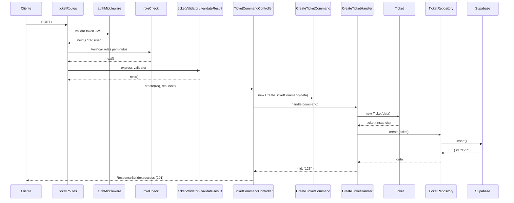
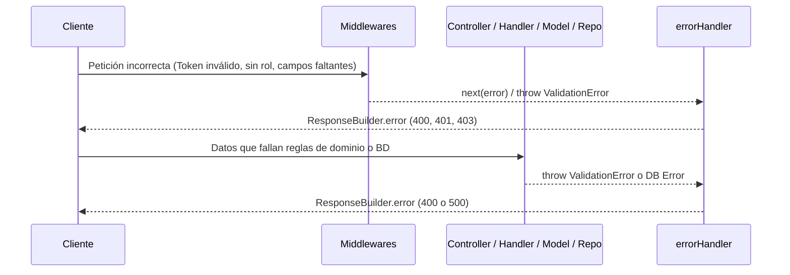

# Reporte Técnico: Funcionalidad "Crear ticket" (HU-03)

## 1. Resumen
La funcionalidad "Crear ticket" permite a los usuarios con rol autorizado (Colaborador, Gerente, Administrador) crear un nuevo ticket en el sistema. Valida los datos de entrada, asegura la creación del objeto de dominio, persiste el registro en la base de datos (Supabase) y devuelve el ID del ticket recién creado dentro de una estructura de respuesta estándar.

## 2. Mapa de archivos involucrados

| Archivo | Capa | Responsabilidad |
|---------|------|-----------------|
| `src/routes/ticketRoutes.js` | Enrutamiento | Define la ruta `POST /` y orquesta los middlewares y el controlador. |
| `src/middlewares/auth.js` | Middleware | Valida el token JWT y añade el usuario al objeto request (`req.user`). |
| `src/middlewares/roleCheck.js` | Middleware | Verifica que el usuario tenga un rol permitido. |
| `src/validators/ticketValidator.js` | Middleware/Validación | Define las reglas de validación HTTP sobre el cuerpo de la petición. |
| `src/utils/validatorHelpers.js` | Middleware/Validación | Ejecuta las validaciones y lanza error si hay fallos. |
| `src/controllers/TicketCommandController.js` | Controlador | Transforma el request HTTP en un `Command` y delega la ejecución. |
| `src/commands/tickets/CreateTicketCommand.js` | Comando (DTO) | Estructura de datos inmutable que transporta la intención de crear un ticket. |
| `src/commands/tickets/CreateTicketHandler.js` | Manejador (Handler) | Ejecuta la lógica de negocio (instancia la entidad y llama al repositorio). |
| `src/models/Ticket.js` | Dominio (Entidad) | Representa la regla de negocio y estado del Ticket (validaciones de dominio). |
| `src/repositories/TicketRepository.js` | Repositorio (Acceso a datos) | Persiste el Ticket en la base de datos Supabase. |
| `src/contracts/index.js` | Contrato (Interface) | Define el contrato (vía JSDoc) `ITicketRepository` que debe cumplir el repositorio. |
| `src/config/container.js` | Inyección de Dependencias | Configura e instancia las dependencias y el handler, pasándolos al controlador. |
| `src/middlewares/errorHandler.js` | Middleware | Captura cualquier error no manejado y estandariza la respuesta de error. |
| `src/utils/responseBuilder.js` | Presentación | Formatea de forma estándar las respuestas de éxito (`success`) o error (`error`). |

## 3. Diagramas de Flujo

### Flujo Completo y Éxito


### Rutas de Error


## 4. Flujo Paso a Paso

### 1. `src/routes/ticketRoutes.js`
Define y compone la cadena de ejecución para la ruta POST.
```javascript
router.post(
  '/',
  roleCheck([UserRole.COLABORADOR, UserRole.GERENTE, UserRole.ADMINISTRADOR]),
  ticketValidator,
  validateResult,
  ticketCommandController.create
);
```

### 2. `src/middlewares/auth.js`
Extrae el token del header `Authorization`, lo decodifica usando `jwt.verify` y asigna el payload decodificado a `req.user`. Si falla, responde con error 401 directamente usando `ResponseBuilder`.
```javascript
const token = authHeader.split(' ')[1];
try {
  const decoded = jwt.verify(token, jwtConfig.secret);
  req.user = decoded;
  next();
} catch {
  return ResponseBuilder.error(res, 'Token no valido o expirado', 401);
}
```

### 3. `src/middlewares/roleCheck.js`
Verifica si alguno de los roles en `req.user` se encuentra en la lista de roles permitidos. Si no, devuelve un error 403 utilizando `ResponseBuilder`.
```javascript
const hasPermission = userRoles.some(userRole =>
  allowedLower.includes(String(userRole).toLowerCase())
);

if (!hasPermission) {
  return ResponseBuilder.error(res, 'No tienes permisos para realizar esta accion', 403);
}
```

### 4. `src/validators/ticketValidator.js` y `src/utils/validatorHelpers.js`
El primero configura express-validator para revisar campos requeridos (`title`, `description`, etc.). El helper chequea si `validationResult(req)` contiene fallos y si es así llama a `next(new ValidationError(errors))`.
```javascript
const validateResult = (req, res, next) => {
  const errors = validationResult(req);
  if (!errors.isEmpty()) {
    return next(new ValidationError(errors.array()));
  }
  next();
};
```

### 5. `src/controllers/TicketCommandController.js`
Recibe los datos sanitizados de la ruta y los usa para construir un objeto puro `CreateTicketCommand`, el cual es pasado al `createTicketHandler`. El resultado es devuelto mediante `ResponseBuilder.success`.
```javascript
const command = new CreateTicketCommand({
  title: req.body.title,
  description: req.body.description,
  priority: req.body.priority,
  departmentId: req.body.department_id,
  userId: req.user.id
});
const result = await createTicketHandler.handle(command);
return ResponseBuilder.success(res, result, 'Ticket creado exitosamente', 201);
```

### 6. `src/commands/tickets/CreateTicketHandler.js`
Usa los datos del comando para instanciar la entidad de dominio `Ticket` y luego le pide al repositorio guardarlo en persistencia.
```javascript
async handle(command) {
  const ticket = new Ticket({
    title: command.title,
    description: command.description,
    priority: command.priority,
    department_id: command.departmentId,
    created_by: command.userId
  });
  const result = await this.ticketRepository.create(ticket);
  return { id: result.id };
}
```

### 7. `src/models/Ticket.js`
Valida la integridad de dominio. Reglas de negocio como los valores permitidos de "priority" se aplican aquí. Si los datos son inválidos, lanza un `ValidationError`.
```javascript
if (!priority || !['Baja', 'Media', 'Alta', 'Critica'].includes(priority)) {
  throw new ValidationError('La prioridad debe ser Baja, Media, Alta o Critica', 400);
}
this.title = title.trim();
//...
```

### 8. `src/repositories/TicketRepository.js`
Envía la consulta mediante la librería del cliente de Supabase hacia la base de datos, mapeando las propiedades de la entidad.
```javascript
async create(ticketData) {
  const { data, error } = await this.supabase
    .from('tickets')
    .insert({
      title: ticketData.title,
      // ...
    })
    .select('id').single();
  if (error) throw error;
  return data;
}
```

## 5. Capas de Validación
- **Validación HTTP (`express-validator` en `ticketValidator.js`):** Valida de forma temprana la presencia de los campos requeridos (`title`, `description`, `priority`, `department_id`) en la petición JSON.
- **Validación de Dominio (`Ticket.js`):** Valida que los datos formen un estado consistente. Revalida que existan los strings (como title y description, lanzando excepciones propias), y además agrega reglas exclusivas de negocio, como limitar la prioridad a `Baja, Media, Alta, Critica`.
- **Duplicidad detectada:** Se valida que los campos `title`, `description` y `priority` no sean nulos o vacíos en el middleware HTTP y luego otra vez dentro del constructor del modelo.

## 6. Manejo de Errores
- **Autenticación/Roles:** Lanza respuestas directas HTTP 401 y 403 a través de `ResponseBuilder` saltándose el middleware global en algunos casos.
- **Validación HTTP y de Dominio:** Lanzan instancias de `ValidationError` (status 400). Pasan por el `catch(error) { next(error) }` del controller y caen a `src/middlewares/errorHandler.js`.
- **Supabase/Infraestructura:** La promesa fallida tira la excepción la cual escala por el catch del controller al `errorHandler.js` resultando en un HTTP 500 (al no tener la propiedad `statusCode`).
- El middleware de errores usa a su vez `ResponseBuilder.error` y registra en logger la traza.

## 7. CQRS
Esta funcionalidad se clasifica como un **Command** (escritura) porque se encarga estrictamente de cambiar el estado del sistema (insertar en base de datos) y no devuelve una consulta de estado, únicamente devuelve el indicador de que la operación tuvo éxito (el `{ id: result.id }`). 
La separación lectura/escritura (CQRS) se cumple porque existe una separación de clases `*QueryController` (lecturas con `ReadModel`) vs `*CommandController` (comandos de escritura empleando `Handler` y un `Repository` de persistencia).

## 8. SOLID
- **(S) Responsabilidad Única (SRP):** 
  - **Cumple:** Cada archivo tiene un rol clarísimo (el Validator valida JSON, el Controller orquesta HTTP, el Handler dirige el negocio, el Repo se conecta a la BD). Evidencia: `src/commands/tickets/CreateTicketHandler.js` (Línea 11, sólo instancia el modelo y persiste).
  - **No cumple:** Nada grave, pero `Ticket.js` mezcla el rol de entidad pura (estructural) con validaciones imperativas en el mismo constructor que arrojan una dependencia específica (`ValidationError`).
- **(O) Abierto/Cerrado (OCP):**
  - **Cumple:** Si requieres más manejadores, se crearán nuevos commands y handlers, en vez de inflar el controlador.
- **(L) Sustitución de Liskov (LSP):**
  - En TypeScript se notaría más, pero aquí `TicketRepository` es compatible con el contrato documentado en `ITicketRepository`.
- **(I) Segregación de Interfaces (ISP):**
  - **Cumple:** El contrato `ITicketRepository` (`src/contracts/index.js`) tiene una única función de escritura, separada de `ITicketReadModel` que es exclusivo para lectura. 
- **(D) Inversión de Dependencias (DIP):**
  - **Cumple:** El `CreateTicketHandler` inyecta en su constructor la dependencia de persistencia `{ ticketRepository }` (línea 7). Esto permite mockear el repositorio fácilmente y no está acoplado con Supabase.

## 9. Inyección de Dependencias
Todo el árbol de dependencias es ensamblado estáticamente en el archivo `src/config/container.js`:
1. Instancia clientes (Supabase).
2. Pasa `dataClient` a `new TicketRepository({ supabase })`.
3. Pasa esa instancia a `new CreateTicketHandler({ ticketRepository })`.
4. El controller factory (`ticketCommandControllerFactory`) es llamado en las rutas (`src/routes/ticketRoutes.js` línea 13) pasando al manejador: `ticketCommandControllerFactory({ createTicketHandler })`.

## 10. Observaciones y Mejoras

1. **Respuestas Inconsistentes en Middlewares:** 
   - **Archivo:** `src/middlewares/auth.js` (Línea 8, 17) y `src/middlewares/roleCheck.js` (Línea 7, 22). 
   - **Problema:** Retornan la respuesta inmediatamente vía `ResponseBuilder.error` en lugar de instanciar un error personalizado y mandarlo al `next()`. Esto rompe el flujo que captura el `errorHandler.js`.
   - **Mejora sugerida:** Crear excepciones propias (ej: `UnauthorizedError`, `ForbiddenError`) y hacer `return next(new UnauthorizedError())` para centralizar todo en el manejador de errores.

2. **Validaciones Duplicadas (DRY):**
   - **Archivos:** `src/validators/ticketValidator.js` y `src/models/Ticket.js`.
   - **Problema:** El campo `title` y `description` son validados como obligatorios en ambos niveles.
   - **Mejora sugerida:** Dejar que express-validator controle solo tipos/presencia y el modelo controle reglas ricas (por ejemplo los estados permitidos 'Baja', 'Alta', etc.). 

3. **Contratos Débiles:**
   - **Archivo:** `src/contracts/index.js`.
   - **Problema:** En JSDoc es difícil hacer forzoso el contrato.
   - **Mejora sugerida:** Utilizar clases base genéricas que arrojen "NotImplemented" al instanciarse o migrar a TypeScript.

## 11. Conclusión
La implementación de la creación de Tickets (HU-03) sigue en gran medida y correctamente los principios de CQRS y las arquitecturas limpias para un entorno Node.js, manteniendo una alta cohesión, una muy buena separación de responsabilidades a través de handlers y repositorios y un manejo de dependencias limpio; salvo por algunos detalles de acoplamiento de control de flujo en middlewares y duplicidad en reglas estructurales, la solución es altamente mantenible y testeable.
